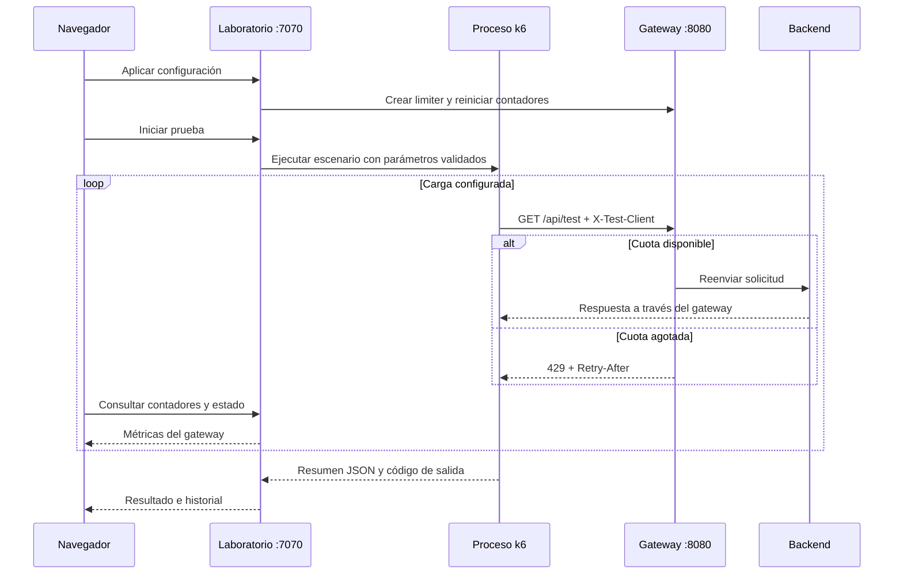

# Rate Lab: interfaz local de pruebas

## Ejecutar en Windows

1. En tu clon del repositorio, trae y selecciona la rama del panel:
   ```powershell
   git fetch origin
   git switch codex/frontend-lab
   ```
2. Comprueba `go version` (Go 1.23 o superior). Para carga real instala k6 siguiendo
   [la documentación oficial](https://grafana.com/docs/k6/latest/set-up/install-k6/):
   ```powershell
   winget install k6 --source winget
   ```
   Abre una terminal nueva y comprueba `k6 version`.
3. Desde la raíz del repositorio:
   ```powershell
   cd gateway
   go run ./cmd/lab
   ```
4. Abre http://127.0.0.1:7070. No abras index.html como archivo: necesita la API del laboratorio.
5. Para terminar, presiona Ctrl+C en la terminal. Exporta antes los resultados.

No requiere Node, npm, Redis ni Docker. Sin k6 instalado, puedes probar manualmente.
El binario k6 se detecta al arrancar, por lo que debes reiniciar después de instalarlo.
Si un puerto está ocupado, detén el proceso anterior o usa:

```powershell
go run ./cmd/lab --port 7071 --gateway-port 8081
```

Para usar tu backend en vez de la demostración:

```powershell
go run ./cmd/lab --upstream http://127.0.0.1:9000
```

El backend debe responder a GET /api/test. Las pruebas k6 consideran esperado un 200
del backend o un 429 del limiter. El backend demo siempre responde 200.
Los errores de conexión generan 502. El timeout del proxy del laboratorio es 5 s.

## Primera prueba manual

1. Selecciona **Token Bucket**, límite 2, ventana 60000 ms, capacidad 2 y recarga
   0.033333 tokens/s. Pulsa **Aplicar y reiniciar**.
2. Conserva la identidad `cliente-demo` y pulsa **Enviar 10 seguidas**.
3. En un envío local rápido, espera dos 200 y ocho 429. Tras unos 30 s se recupera
   un token; no es necesario esperar que termine una ventana fija.
4. Cambia la identidad a `otro-cliente`. Tiene su propia cuota y puede obtener un 200.
5. Para Fixed Window, Sliding Log y Sliding Counter usa límite 2 y ventana 60000 ms.
   Aplica antes de cada experimento. Capacidad/recarga solo aplican a Token Bucket.

Las ventanas fijas se alinean al reloj: una prueba que atraviesa un borde puede admitir
más solicitudes. Sliding Log cuenta las admisiones de los últimos 60 s; Sliding Counter
aproxima esa cuenta ponderando la ventana anterior. Estos comportamientos explican
por qué los cuatro algoritmos no producen necesariamente la misma secuencia.

La tabla muestra las últimas 20 respuestas manuales. Su duración mide el viaje del
servidor del panel al gateway y la lectura de la respuesta; no mide exclusivamente
el algoritmo. La gráfica muestra deltas de contadores por intervalo de sondeo, no
latencia ni cada solicitud individual. En pestañas inactivas el sondeo puede retrasarse.

## Ejecutar y comparar k6

1. Configura límite 100 y ventana 1000 ms. Para Token Bucket usa capacidad 100 y
   recarga 100 tokens/s. Aplica la política.
2. Escoge **Carga sostenida**, 200 solicitudes/s, 15 s y un cliente.
3. Pulsa **Iniciar prueba**. Cada ejecución reinicia cuotas y contadores; mientras
   corre se bloquean cambios y solicitudes manuales desde el panel.
4. Consulta el resultado y descarga su JSON. Repite con los otros algoritmos,
   manteniendo parámetros y carga. Haz varias repeticiones.
5. Prueba **Ráfaga y recuperación**: 3 s a 10 req/s, 1 s de subida, pico durante la
   duración elegida, 1 s de bajada y 5 s a 10 req/s. Dura 10 s más que el pico.

El tráfico se reparte por igual entre las identidades indicadas. La cuota es **por
cliente**, por lo que 200 req/s repartidas entre 10 clientes no equivalen a 200 req/s
para un cliente. Usa la misma cantidad para comparar algoritmos. No generes tráfico
externo simultáneo si quieres asociar los contadores del gateway solo al experimento.

| Resultado | Interpretación |
| --- | --- |
| Admitidas (200) | Solicitudes k6 que recibieron 200 del backend. |
| Limitadas (429) | Cuota agotada; comportamiento esperado, no fallo HTTP del ensayo. |
| p95 admitidas | El 95% de las duraciones HTTP de respuestas 200 no supera este valor. No incluye conexión inicial y no aísla el costo del limiter. |
| Errores HTTP inesperados | Respuestas fuera de 200/429 o fallos de red. Deben investigarse. |
| Iteraciones no iniciadas | k6 no sostuvo la carga objetivo con los VUs disponibles; no son rechazos del gateway. |

Una prueba completa exige checks al 100%, cero errores HTTP inesperados y cero
iteraciones no iniciadas. **Completada no demuestra por sí sola exactitud del
algoritmo**: esos umbrales verifican salud del ensayo. La validación determinista
de los algoritmos está en los tests Go. Una cancelación puede no producir resumen.
La salida de k6 explica fallos de umbrales o de ejecución.

En la vista general, “admitidas por el gateway” cuenta decisiones de admisión:
puede incluir un posterior error del backend. Por eso no equivale necesariamente
al contador 200 de k6. “Errores del sistema” incluye fallos del limiter y de conexión
al upstream, no todas las respuestas no-200 que devuelva tu API.

El historial conserva las últimas 10 ejecuciones del proceso, con configuración y
resumen completo de k6, incluidos p95/p99 y tiempos de rechazos cuando existan.
El gráfico conserva 45 muestras en el navegador y no se guarda en el JSON.
Recargar la página conserva el historial del proceso, pero pierde tabla manual y
gráfico. Cerrar el proceso pierde todo lo que no hayas exportado.

## Arquitectura y límites

- `cmd/lab`: composición, backend demo y servidores HTTP solo en loopback.
- `internal/lab`: API de control, recursos web embebidos y ejecución de k6.
- `internal/lab/web`: HTML semántico, CSS adaptable y JavaScript sin dependencias.
- `internal/lab/scenario.js`: escenario k6 real, embebido y escrito a un directorio
  temporal por ejecución. Se elimina al terminar.
- `internal/proxy`: el mismo gateway de v1; Snapshot expone contadores.

El panel usa GET /api/status y POST /api/config, /api/probe, /api/runs y /api/stop.
Se valida JSON, rangos, Host y Origin. Solo se ejecuta el binario k6 detectado, sin
shell ni argumentos libres enviados por el navegador. Una prueba activa por proceso,
máximo 2000 req/s, 120 s de duración/pico, 1000 clientes y 200 VUs. No hay persistencia,
usuarios, distribución ni autenticación. No expongas este laboratorio como panel público.
La cabecera X-Test-Client es una identidad de prueba, no una credencial.
El Docker Compose existente arranca el flujo CLI; el panel usa el comando local anterior.



## Validación

```sh
cd gateway
go test ./...
go vet ./...
go test -race ./...
```

La prueba TestK6Execution se ejecuta cuando k6 está en PATH; de otro modo se omite
explícitamente. CI instala k6 para verificarla. En Windows `-race` requiere un
compilador C compatible; CI lo verifica en Linux. Los tests comprueban los cuatro
algoritmos a través del panel, aislamiento, reinicios, validación y bloqueo de origen.

Referencias: [instalación k6](https://grafana.com/docs/k6/latest/set-up/install-k6/),
[métricas k6](https://grafana.com/docs/k6/latest/using-k6/metrics/reference/).
