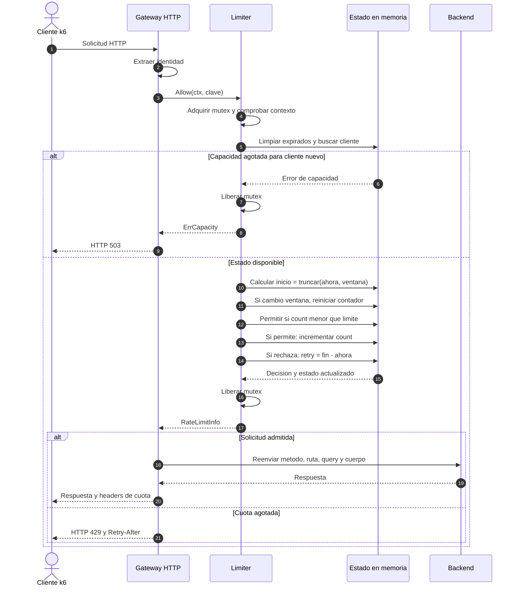
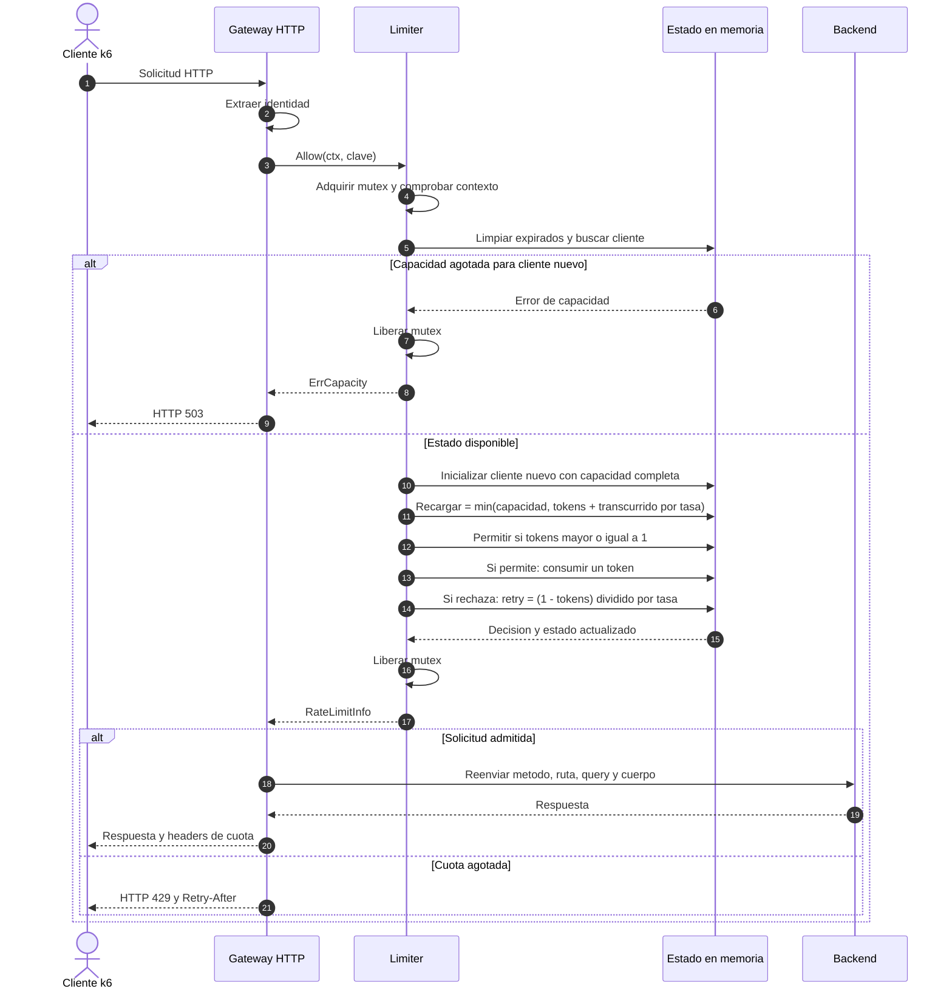
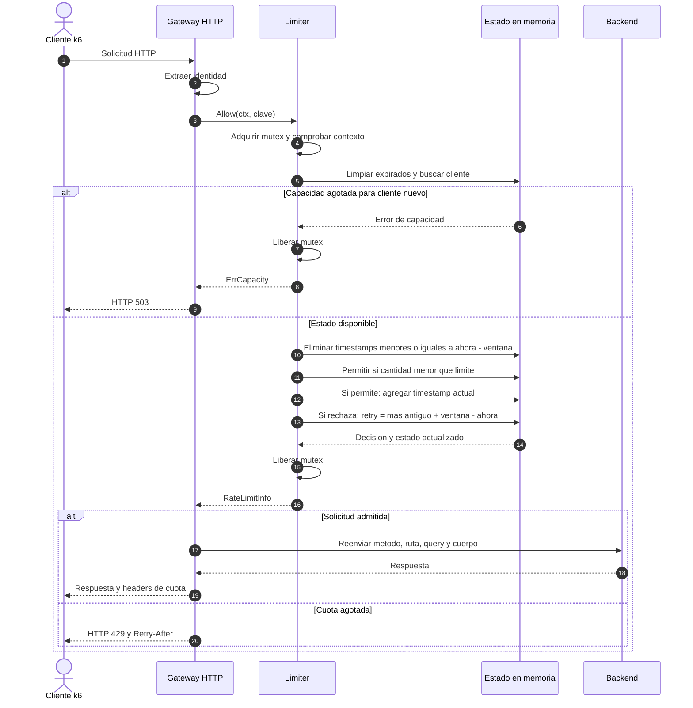
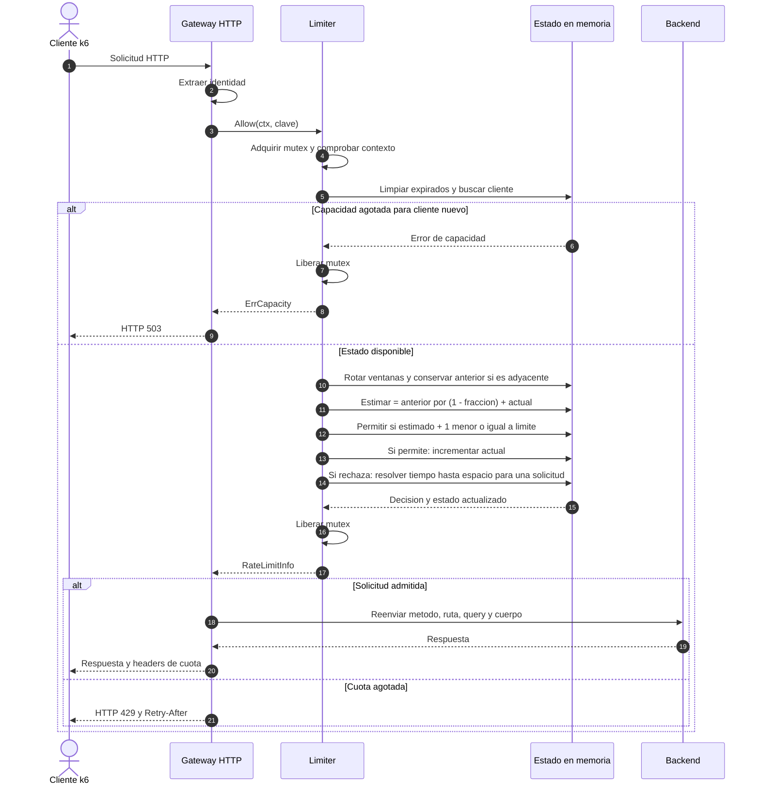

# Diagramas de secuencia — implementación v1

Los cuatro diagramas corresponden al motor local con mutex. No representan Redis.

## Fixed Window

## Token Bucket

## Sliding Window Log

## Sliding Window Counter

